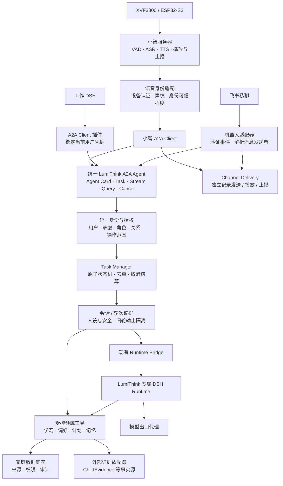

# LumiThink 基于 A2A 的多渠道家庭智能体整体方案

| 项目 | 内容 |
| --- | --- |
| 文档版本 | 1.1，正式设计基线（第二轮复评通过，含实现前细节补充） |
| 编制日期 | 2026-10-25 |
| 状态 | 设计评审通过（Design GO）。P0/P1 获准开展，协议互通、真实取消、设备验收和部署切换仍受各阶段 Gate 约束。 |
| 核心决策 | 一套 LumiThink Agent；A2A 统一接入；家庭租户；统一用户身份；按用户及数据关系授权 |
| 首期渠道 | 工作 DSH 插件、飞书机器人、xiaozhi-esp32-server / XVF3800 |
| 基线范围 | 本文冻结设计；当前发布的是文档与任务计划，工程实现及验收由 P0/P1 Issues 承接 |

配套设计：[Task 生命周期与运行时执行契约](TASK_LIFECYCLE.md)。V1.0 初稿未随本次基线归档；评审变更记录保留在本文 §18–§19。评审意见处理记录见 §18。

## 1. 方案摘要

LumiThink 建设为独立部署、可被其他平台调用的家庭智能体服务，对外采用 A2A 协议，对内继续复用现有 DSH Runtime 和 Runtime Bridge。

对外只有一套 LumiThink Agent。陪伴聊天、学习记录查询、学习活动记录和监护人建议，是同一个 Agent 的业务能力，不再拆为 Companion、Learning 两个逻辑 Agent。

工作 DSH 和飞书通过用户系统识别访问者；XVF3800 通过设备认证确定家庭，再结合声纹选择候选用户。声纹匹配仅支持低敏感个性化，访问私有数据需要进一步验证身份。三条路径统一经过客户端身份和操作主体两级认证，并执行同一套授权规则。

家庭作为租户，家庭业务数据采用统一底座。不同成员通过权限读取和写入相应数据；数据可跨渠道复用，但不自动向所有家庭成员开放。当前聊天上下文按会话及参与者管理，不能因为采用同一个 Agent，就共用一个 DSH 会话或无条件拼接所有人的历史。

小智继续承担设备接入、VAD、ASR、TTS、音频队列和即时止播。LumiThink 负责智能体业务、安全、上下文、学习与记忆、执行编排和运行时取消。

首期采用 A2A v1.0.1 规范基线、JSON-RPC over HTTPS 和 SSE；协议交互版本为 `1.0`。OpenAI-compatible 接口不纳入本期范围，不新增自定义跨服务聊天、任务查询或取消 RPC。

V1.1 冻结六项工程约束：所有成功受理的正式交互采用 Task；Task Manager 是对外任务状态的唯一权威；首期认证采用受限凭据和服务端身份绑定；公开语音正文只追加；生成与渠道交付分别管理；先验证真实 DSH 执行闭环，再迁移既有语音链路。

## 2. 背景、现状与目标

### 2.1 既有部署基线

以下信息来自 2026-10-24 的对话核查记录，本轮未重新检查运行环境，实施前必须复核。

| 项目 | 记录中的现状 |
| --- | --- |
| 部署 | Windows 宿主上的 WSLc 容器承载小智服务器、LumiThink Gateway、DSH 工作进程及模型出口代理 |
| 设备 | ReSpeaker XVF3800 + XIAO ESP32-S3，使用小智设备协议 |
| 语音 | 小智负责豆包 ASR、TTS 及音频传输 |
| 小智到 LumiThink | 自定义 Provider，经本地 Unix socket 及专用 JSON 帧通信 |
| LumiThink 到内部 DSH | Runtime Bridge，通过子进程标准输入、标准输出交换控制与事件 |
| 业务能力 | 当前设备链路使用 E2E-02 测试 profile，不能据此认定正式人设、业务工具和长期记忆已接通 |
| 数据与日志 | 持久化根目录为 `C:\CODE\lumithink-data\xiaozhi-esp32-server`；网关日志已落盘，DSH 诊断日志尚不完整 |
| 代码一致性 | 部署运行目录存在额外补丁，尚需与主仓库核对 |
| 稳定性 | 有真实对话与打断成功记录，也出现过设备 hello 被拒绝；历史跑通不等于当前持续稳定 |

### 2.2 建设目标

1. LumiThink 可独立启动、配置、升级、排障和恢复。
2. 三种渠道通过同一 A2A 服务访问同一个家庭智能体。
3. 同一自然人在不同渠道映射到同一个 LumiThink 用户。
4. 家庭业务事实可复用，权限、会话和参与者边界明确。
5. 保留现有安全准入、旧轮输出隔离及实际运行时取消能力。
6. 学习结论有数据来源，记录不足时明确说明。
7. 支持渐进切换及逐渠道回滚。

### 2.3 首期范围限制

- 飞书先支持授权账户私聊和文本结果，不将群聊、主动通知、图片及语音消息列为首期必需项。
- 工作 DSH 作为客户端调用 LumiThink；不直接访问家庭数据库或内部运行时。
- 学习业务先提供只读查询，写入能力在身份、来源和权限机制验证后逐项开放。
- 首期不要求跨主机部署；同机独立服务即可，存储和接口边界需支持后续拆分。
- 不承诺声纹模块、SDK、插件或运行时恢复已达到生产要求，均需验证。

## 3. 总体架构

图中领域工具是同一套服务能力，既可由确定性业务路径调用，也可由内部 DSH 调用，均执行相同授权。

### 3.1 职责边界

| 组件 | 职责 |
| --- | --- |
| 小智 | 设备连接、音频处理、识别和合成、播放流控、即时止播 |
| 声纹识别模块 | 输出说话人候选及识别证据；不直接决定业务权限 |
| 渠道适配器 | 渠道身份转换、上下文映射、消息去重、A2A 调用、结果呈现 |
| LumiThink 接入层 | A2A 协议处理、认证、任务及订阅访问控制 |
| Task Manager | 唯一写入对外 Task 状态；原子更新、幂等受理、取消结算及恢复 |
| 身份与授权层 | 统一用户、家庭成员关系、权限决策和身份确认要求 |
| 会话与轮次编排 | 历史选择、运行时会话映射、并发、取消、旧轮隔离 |
| 领域服务 | 学习事实、计划、偏好、记忆的受控读写和来源管理 |
| 内部 DSH | 推理、受控工具调用及运行时执行 |
| Channel Delivery | 管理各渠道发送、播放、止播及重试；不修改 Task 生命周期 |

LumiThink Core 不依赖声纹服务、设备在线状态、TTS Session、编解码或音频队列。语音能力不可用时，文本 Agent 仍可独立运行；声纹不可用时，设备仍可进行受限的通用聊天。Core 只消费渠道无关的身份上下文及可选交付摘要。

### 3.2 两个 DSH 实例

工作 DSH 是外部客户端，通过插件请求 LumiThink。LumiThink 内部 DSH 是专属执行引擎，通过现有 Runtime Bridge 接受编排。

二者分别维护会话、文件目录和模型上下文。工作 DSH 默认仅提交本次请求所需内容；工作区文件、企业文档及完整工作历史不自动附带。LumiThink 仅返回授权结果。

## 4. 单 Agent 能力组织

对外发布一个 `lumithink` Agent Card，声明聊天、学习查询等能力。Skill 用于能力发现，不作为身份依据或权限边界，也不假定客户端所选 Skill 会自动可靠地路由到指定业务操作。

内部建议提供以下受控能力，名称仅为设计示意，不是新增 A2A 方法：

| 领域能力 | 主要行为 | 开放顺序 |
| --- | --- | --- |
| 日常聊天 | 按当前用户及场景交流 | 首期 |
| 学习查询 | 查询活动、周期、记录覆盖情况及来源 | 首期业务接入 |
| 学习摘要 | 根据真实记录形成解释和建议 | 事实查询可用后 |
| 学习活动记录 | 新增有来源的活动记录 | 写入权限验证后 |
| 偏好管理 | 查询和修改允许的个人偏好 | 按权限逐项开放 |
| 学习计划管理 | 查询、建议或调整计划 | 先查询，后写入 |
| 记忆检索 | 检索当前主体有权访问的长期信息 | 记忆权限验证后 |

简单确定性查询可直接调用领域服务；需要解释、交流和综合推理时调用内部 DSH。所有路径必须经过相同的数据权限检查。

### 4.1 外部事实与知识服务契约

ChildEvidence 等服务通过领域适配器接入，不将外部数据库结构变成 LumiThink Core 的依赖，也不默认这些服务已经接通。首期契约采用内部工具接口：

| 内部操作 | 输入 | 返回与约束 |
| --- | --- | --- |
| `queryEvidence` | 授权后注入的家庭和对象范围、周期、类别、分页 | 证据引用、事实、来源版本、更新时间、覆盖情况及下一页标识 |
| `getEvidence` | 证据引用及授权上下文 | 获准查看的依据；逐条校验引用归属，不靠 ID 保密 |
| `getSourceStatus` | 授权的数据源范围 | 可用性、最近更新时间及覆盖范围，不泄露未授权对象是否存在 |

模型只能提供业务查询条件，家庭与用户权限由服务端注入。适配器使用限定的数据源凭据及超时、并发预算；外部服务不支持细粒度授权时，适配器承担查询范围约束，原始结果不得绕过筛选进入模型。

LumiThink 保存必要的来源引用、摘要及授权缓存，不默认为外部事实建立第二份可独立修改的主记录。来源不可用、来源过期与查询结果为空分别返回；发生来源冲突时保留证据并说明差异。首期不开放外部事实写入。

## 5. 家庭租户与统一用户模型

### 5.1 核心对象

| 对象 | 核心内容 | 约束 |
| --- | --- | --- |
| `household` | 家庭标识、状态 | 数据所属租户 |
| `user` | LumiThink 统一用户标识 | 不与渠道账号或设备等同 |
| `membership` | 用户、家庭、角色、状态 | 角色在家庭内生效 |
| `relationship` | 监护人与被监护人的关系 | 不能仅凭“家长”角色访问任意儿童 |
| `identity_binding` | 渠道、渠道主体、统一用户、绑定状态 | 绑定需可信确认且可撤销 |
| `device` | 设备标识、所属家庭、状态 | 证明终端归属，不证明当前说话人 |
| `voice_profile` | 声纹档案与用户绑定 | 注册、更新和删除受控 |
| `conversation` | 家庭、参与者、渠道、用途、状态 | 明确历史和参与者边界 |
| `task_binding` | A2A Task、内部 Turn、运行时执行及会话映射 | 各标识有独立生命周期 |

一个用户可在多个家庭拥有不同关系；首期可以只支持一个家庭，但数据模型不将用户角色固化为全局角色。

### 5.2 冻结两级身份认证

首期采用服务端存储的随机不透明 Bearer 凭据及绑定记录，不建设完整 OAuth 授权服务器。所有凭据经 HTTPS 传递；服务端只保存令牌摘要及授权记录，检查期限、撤销、受众、客户端和操作范围。

每次请求同时确定：

1. **Client Identity：**哪个已登记的客户端或适配器在调用。
2. **Principal Identity：**本次代表哪个已验证用户，或哪个受限访问者；身份依据和可信程度是什么。

一个 Bearer 凭据可以绑定上述两级身份，不要求叠加两种 HTTP 认证头。用户级权限必须由服务端绑定关系解析，不能从消息正文或普通 metadata 接受任意 `user_id`。

| 渠道 | 凭据及证据 | 服务端主体解析 | 凭据权限上限 |
| --- | --- | --- | --- |
| 个人 DSH Profile | 用户专属 Bearer 凭据 | 凭据记录绑定 `client_id + user_id + household_id` | 已授予该 Profile 的业务权限，首期只读学习能力 |
| 飞书 | 已登记入口验证的应用事件和发送者；适配器专属服务凭据 | 身份入口从验证事件解析应用、飞书租户及发送者，查询绑定，签发限定执行凭据 | 服务凭据仅可处理本应用的事件，不能凭提交的用户 ID 直接读家庭数据 |
| 小智 | 受限适配器凭据、已认证设备连接、声纹证据 | 设备绑定确定家庭；声纹仅建立候选用户，验证授权后才能建立用户主体 | 默认通用聊天和允许的低敏感个性化，无监护人私有数据权限 |

飞书事件入口属于认证信任边界，负责验证事件来源；普通 A2A Client 不能伪造该入口的验证记录。入口登记事件 ID、发送者及消息摘要，身份模块据此签发短期执行凭据。凭据绑定客户端、有效家庭、主体、渠道会话及允许的任务；新请求需与验证消息关联，后续查询和取消需与已受理 Task 关联。不能用一个已验证事件为任意新请求获取用户身份。

小智经已登录 DSH / 飞书确认设备会话后，可获得服务端签发的短期身份授权。授权绑定用户、设备、连接代际、会话、范围及期限；候选说话人变化、连接重建、解绑或到期即失效。声纹高置信度本身不能签发这种授权。

适配器执行凭据首期有效期上限为 5 分钟；过期后的查询或取消由身份模块重新检查原事件 / 会话绑定、当前成员关系和任务归属后续签。个人 DSH 凭据设置明确到期时间和可撤销范围；更换凭据不更换稳定 `client_id`。上述时间是设计配置，需在实现中验证，不代表现有系统已具备。

### 5.3 可信上下文、绑定与撤销

身份层输出内部上下文：`client_id`、`principal_id`、已验证时的 `user_id`、经授权的 `household_id`、可选 `device_id`、`candidate_user_id`、`assurance`、绑定版本、策略版本及权限范围。候选用户与操作主体分别保存，候选字段不能被领域工具当作已验证用户。

家庭范围必须来自有效成员关系或受限设备绑定；A2A `tenant` 仅用于接口路由，不能直接赋值给 `household_id`。即使两者偶然同名也必须独立校验。

DSH 首期限定个人独立 Profile。多人共用实例需分别登录和分配凭据，不能复用监护人 Token。飞书绑定与解绑由已认证用户完成，绑定键包含应用和飞书租户范围。同一个人的 DSH 与飞书身份可映射到同一个用户，但不自动合并历史。

入口在每次请求检查凭据及绑定状态；领域工具和结果交付检查当前策略版本。任务记录受理时身份和权限版本用于追踪，不将其视为永久权限快照。用户或权限撤销后，旧任务的未交付内容和订阅同样停止；已经发送的内容无法靠撤销追回。

## 6. XVF3800 声纹识别与用户切换

### 6.1 处理流程

`设备认证 → 确定家庭 → ASR 与可选声纹识别 → 解析受限 / 已验证主体 → 操作授权 → A2A 调用`

在小智音频链路增加声纹识别环节。声纹服务位置、模型和阈值为待验证选型；不能将设备已有音频前处理能力视为声纹识别能力已经落地。

ASR 与声纹识别可并行处理。声纹超时或服务不可用时，普通语音聊天继续以受限身份运行，不阻塞首句响应。私有查询和个人写入必须获得相应的已验证身份授权；若缺少授权，转到已登录渠道确认，不能等待一个更高声纹分数来替代认证。

### 6.2 三层身份能力

| 结果 | 系统行为 |
| --- | --- |
| 未识别 | 通用陪伴聊天，不读取私有信息，不向确定用户写入个人事实 |
| 声纹匹配 | 使用候选用户允许在共享设备上使用的称呼、交流风格等低敏感信息；实际主体仍受限 |
| 已验证身份 | 经已登录渠道确认并获得有效的设备会话授权后，按授权访问相应数据；高权限操作另行确认 |

声纹匹配不排除重放、背景声音和多人场景，因此即使匹配明确，也不自动授予监护人权限或儿童私人学习记录访问权。匹配阈值用于衡量候选识别质量，不是私有数据的授权阈值。权限修改和数据导出在已登录文本渠道完成。

说话人变化或多人交谈触发私人授权失效及参与者重新判断；共同会话另行建立。共享设备可用的低敏感信息使用明确的允许清单，不从完整个人档案中任意取用。

### 6.3 归属与反馈保护

- 身份不确定的发言不能直接记为“某个儿童说过”或更新其个人偏好。
- 当前 Task 的身份在受理时固定；说话人切换通过新身份、新任务和会话切换处理，不能中途替换既有任务主体。
- 切换时废弃旧轮音频及尚未交付的私人回复，避免向新用户继续播放旧用户内容。
- 共享空间中的说话人识别不能证明周围只有该用户；敏感报告默认引导到私人文本渠道查看。
- 声纹注册和重绑定由已认证监护流程管理。声纹模板按敏感身份材料保护，定义留存、撤销和删除规则，不写入普通日志。

## 7. 家庭数据互通与访问控制

### 7.1 统一底座与数据来源

家庭共享的是统一业务数据底座；每个用户看到的是权限范围内的视图。

业务记录至少包含以下信息，实际表结构在实现时细化：

| 信息 | 用途 |
| --- | --- |
| 所属家庭 | 租户隔离 |
| 记录对象 | 描述谁或哪个家庭对象 |
| 创建者 | 谁提交记录，可与记录对象不同 |
| 来源 | 渠道、原始记录或系统观测依据 |
| 数据类别 | 学习活动、计划、偏好、对话、记忆等 |
| 访问策略 | 允许读取、增加、纠正、确认、删除的主体或关系 |
| 事实状态 | 用户陈述、系统观测、模型推断、已确认事实 |
| 时间与版本 | 发生时间、记录时间、更新时间和变更关联 |

例如，监护人在飞书记录儿童完成阅读：创建者是监护人，记录对象是儿童，来源为监护人陈述。它不能被标记成设备自动观测到的事实。

模型推断与业务事实分别管理。模型不能将一次回答中的推测直接写成已确认的长期事实。纠正记录保留来源和变更关系，避免无痕覆盖。

### 7.2 首期建议权限矩阵

下表是业务权限评审建议，儿童与监护人两列均以前述“已验证身份”为前提。仅有声纹匹配时适用受限范围，不能直接套用这两列。

| 操作 | 儿童本人 | 有相应监护关系的用户 | 身份未确认者 |
| --- | --- | --- | --- |
| 普通陪伴聊天 | 允许 | 允许 | 受限允许 |
| 查询儿童本人学习事实 | 允许适龄内容 | 允许授权范围 | 拒绝 |
| 新增儿童自述活动 | 允许，标记自述 | 允许代为记录，标记来源 | 不归属到确定个人 |
| 查询学习计划 | 允许本人相关内容 | 允许 | 拒绝 |
| 调整学习计划 | 提出建议 | 按权限修改 | 拒绝 |
| 修改个人偏好 | 修改本人允许项 | 按监护规则处理 | 拒绝 |
| 查看其他成员原始对话 | 默认拒绝 | 单独授权，不因角色自动全量开放 | 拒绝 |
| 家庭成员、权限及数据导出管理 | 拒绝 | 按角色并确认身份 | 拒绝 |

权限采用“家庭成员角色 + 监护关系 + 数据对象 + 操作类型 + 身份可信程度 + 使用场景”的组合判断。实现为集中策略与领域检查即可，首期不强制引入独立权限平台。

### 7.3 检查位置

1. A2A 入口认证调用主体，确定有效家庭范围。
2. 会话层检查 Context、Task 和参与者归属。
3. 每次领域工具调用检查操作和目标对象。
4. 数据访问层强制租户及授权范围，检索前过滤。
5. 结果交付前核对身份切换、权限撤销和输出场景。

模型提示词用于指导行为，不能承担唯一的权限防线。未经授权的数据不能先进入模型上下文，再依赖模型决定是否说出来。

向量检索、摘要缓存、导出、日志和后台任务同样适用授权。缓存键应包含足以隔离数据及权限的范围；权限撤销后，不能继续通过旧会话、缓存或订阅取得内容。

## 8. 会话、记忆与并发

### 8.1 四种不同状态

| 状态 | 管理方式 |
| --- | --- |
| 家庭业务事实 | 家庭统一存储，按用户及关系授权 |
| 长期记忆 | 带来源、对象及可见范围，检索时授权 |
| 当前对话历史 | 按参与者、用途和会话管理 |
| 运行时上下文 | 当前会话所需的最小授权内容，按需构建 |

同一个人跨渠道可以访问相同事实，但首期默认建立独立渠道会话。跨渠道继续同一聊天需显式选择，并重新检查权限和参与者。

### 8.2 标识映射

建议关系：

`家庭 + 可信用户 / 参与者 + 客户端 + 渠道会话 → 内部 Conversation ↔ A2A contextId`

`A2A taskId ↔ 内部 Turn ID ↔ Runtime 执行 ID`

`contextId` 不是用户身份或权限凭据。Task ID、Context ID 即使被获知，也不能绕过服务端授权。

所有正式业务交互在成功受理后采用 Task。每个新请求创建一个 Task；补充输入使用新的 `messageId` 指向原未完成任务；已终结任务的后续提问在相同 Context 内创建新任务。同一消息的重试返回原 Task，不新建运行。

一个 Task 可经历多个补充输入 / 执行阶段，对应多个内部 Turn；每个 Turn 拥有独立执行代际和 Runtime 执行记录。上述映射是关联关系，不强制所有对象一对一。

### 8.3 并发规则

- 同一私人对话首期采用单个活动交互轮次，明确新输入是排队、补充还是打断。
- 语音交互的新轮次可使旧轮输出失效；此规则限于对应会话，不取消同家庭其他人的任务。
- 不同用户或不同独立会话可以并行，受全局资源上限控制。
- 家庭共享记录的并发修改通过版本、事务或冲突提示处理。
- 家庭共同会话明确参与者及共同可见范围，不能直接复用某位成员的私人上下文。

### 8.4 Task 状态的唯一权威

LumiThink Task Manager 独占对外任务状态的更新权。协议处理器、DSH 回调、取消处理器和恢复扫描器均向它提交事件，不直接修改 Task Store。

Task Manager 以数据库事务及状态版本条件更新来决定转换顺序；同一事务记录状态、已准入结果及待发布事件。运行时回调必须携带 Task、Turn、Execution 和 epoch 关联。终态不再变更，迟到回调不得追加正文或重开任务。

取消意图是持久化内部状态，不增加一个自定义 A2A `CANCELING` 状态，也不等于取消成功。确认执行停止、已完成、失败、取消被拒绝及超时，按明确规则分别结算。权限撤销立即关闭后续输出准入并触发内部取消，即使请求来自旧会话。

完整状态机、取消竞态、存储事务和恢复规则以 [TASK_LIFECYCLE.md](TASK_LIFECYCLE.md) 为准。

## 9. A2A 协议与任务契约

### 9.1 首期绑定和版本

| 项目 | 决策 |
| --- | --- |
| 规范基线 | A2A v1.0.1 |
| 交互版本 | `A2A-Version: 1.0`，按规范声明兼容版本 |
| 传输 | JSON-RPC over HTTPS；流式结果使用 SSE |
| SDK | 服务端优先官方 JS SDK；小智客户端优先官方 Python SDK |
| 版本固定 | 固定具体软件版本、锁文件和互通矩阵，不把规范版本当 SDK 包版本 |
| 可选能力 | Agent Card 仅声明已经实现并通过验证的能力 |

### 9.2 操作映射

| 行为 | A2A 操作或结构 |
| --- | --- |
| 发现能力及认证要求 | Agent Card |
| 提交请求 | `SendMessage` / `SendStreamingMessage` |
| 查询任务 | `GetTask` / `ListTasks`，按调用者权限限定 |
| 订阅既有任务 | `SubscribeToTask`，遵守任务状态限制 |
| 取消执行 | `CancelTask` |
| 回答及结构化业务结果 | Artifact 中的文本及数据 Part |
| 等待补充输入或授权 | 标准任务状态及相应交互流程 |

LumiThink 成功受理的正式交互统一返回 Task，普通聊天和瞬时学习查询也适用，不返回无 Task ID 的独立 Message。认证失败、参数错误等仍返回标准错误，不为了满足 Task 模式而给未授权调用创建任务。

`SendMessage` 遵守客户端的同步 / 立即返回配置；需要恢复和取消的客户端使用 `returnImmediately: true`。`SendStreamingMessage` 先返回 Task，再发布更新；瞬时完成也有真实 Task ID。终态任务通过查询读取，不能假设 `SubscribeToTask` 支持终态订阅。协议字段使用锁定 SDK 的实际表示。

### 9.3 结果契约

学习结果使用版本化领域 Schema，至少包含查询对象、统计周期、数据更新时间、来源引用、覆盖情况、事实结果和证据不足项。自然语言摘要从这些事实形成。

取消请求受理后实际执行完成、但后续正文被抑制时，在 `Task.metadata.lumithinkResult` 返回 `version: 1`、`outputSuppressedAfterCancel: true`、`answerComplete: false`，并给出可读状态说明。LumiThink 客户端必须显示“执行完成，但回答因取消未完整交付”，不得将部分正文当完整答案，语音不自动补播。该标记不新增 A2A 状态。

对话正文、状态提示和工具日志分别处理。仅将经过安全准入、标记为可交付回答的正文交给渠道。内部推理不进入 TTS。

| 输出类型 | 冻结的处理规则 |
| --- | --- |
| `TaskStatusUpdateEvent` | 更新任务状态；需要补充输入时由渠道独立提示，不将整个事件直接送 TTS |
| 回答正文 Artifact | 每个输出阶段使用稳定 Artifact ID，准入后公开；语音适配器仅消费此类正文 |
| 结构化数据 Artifact | 用于客户端渲染和事实引用，不直接拼接为语音 |
| 内部工具和执行事件 | 保留于内部追踪，不作为公开 Artifact 输出 |
| 重发或查询快照 | 重建结果并核对消费位置，不当作新的正文增量 |

**可播正文为只追加契约：**首次事件创建 Artifact，后续 `TaskArtifactUpdateEvent.append` 为 `true`；结束事件的 `TaskArtifactUpdateEvent.lastChunk` 为 `true`。两字段属于更新事件，不属于 Artifact。正文一旦公开，禁止通过替换修改已公开前缀；需要修正时追加明确的纠正内容。`lastChunk` 只表示该 Artifact 结束，Task 终态由 Task Manager 另行结算。

为语音去重，`TaskArtifactUpdateEvent.metadata` 的 `lumithinkOutput` 对象中携带 `version: 1`、稳定的 `chunkId`、正文 UTF-8 字节范围 `[startByte, endByte)` 和该片段的 SHA-256 内容摘要；重发保持相同值。Artifact 级 metadata 仅放正文类别、媒体语义等稳定属性；Task 快照保存聚合后的 Artifact 正文，正文长度可按 UTF-8 计算，不假定快照包含逐片段 metadata。重放所需事件、片段 ID 和水位由持久化 Outbox 保存。它们是 LumiThink 输出元数据契约，不是 A2A 标准字段；普通文本客户端可忽略，小智适配器必须验证。

渠道按 `taskId + artifactId + chunkId` 去重，并检查位置连续性和内容摘要。同标识不同内容视为协议异常，不能播放；不能仅按文本内容去重，否则正常重复词句会被误删。重连以当前快照建立边界，再消费后续增量；没有可靠消费水位时，停止自动续播并走明确恢复流程。

### 9.4 自定义信息边界

身份绑定和登录属于认证与用户管理流程；家庭学习结果的结构属于领域数据契约。两者不等同于重新定义一套聊天协议。

音频播放反馈首期留在 Channel Delivery，不作为 A2A Core 必需输入。后续需要跨服务共享交付摘要时，再声明可选、版本化的扩展；普通文本客户端无需实现它。输出 metadata 的字段和版本在互通样例中公开。不得使用自定义方法替代标准消息提交、任务查询或取消。

## 10. 语音流、打断与交付状态

### 10.1 正常交互

`语音 → 小智 ASR / 可选声纹 → 身份与权限 → A2A 流式任务 → LumiThink / DSH → 准入正文 → 小智 TTS → 设备播放`

保留轻量 `XiaozhiA2AProvider`，将 Task、状态和 Artifact 流转换为小智需要的文本生成器，并关联消息、Task、取消意图和渠道身份句柄。它使用身份服务给出的凭据，不自行计算家庭权限，也不接管 TTS Session 或音频队列。

Provider 根据 §9.3 只交付新增正文；若遇到修改已公开正文的替换事件，拒绝该输出并记录契约异常。TTS、队列清理和设备止播仍由小智原生音频链路处理。

### 10.2 三类完成状态

| 状态 | 权威组件 | 含义 |
| --- | --- | --- |
| 生成完成 | Task Manager | 结果已经完成并持久化，对应 A2A Task 生命周期 |
| 渠道交付 | Channel Delivery | 飞书消息发送结果，或小智合成、排队、音频发送进度 |
| 实际播放反馈 | 小智 / 设备，由 Channel Delivery 记录 | 依据设备实际能力判断播放进度、止播或完成 |

发送帧数和摘要只能证明相应交付过程，不能直接认定用户听到了完整回答。反馈不足时记录“交付不确定”，长期记忆不能默认用户听过所有已生成内容。

Channel Delivery 通过 Task ID、Artifact ID、渠道会话及片段标识关联结果，分别保存发送水位和播放反馈。Task 不等待音频播放完成，播放失败、止播或飞书发送失败也不把已完成 Task 改回失败或运行中。

后续会话需要“上一段是否听到”的信息时，通过领域接口读取可选的交付摘要；摘要缺失表示未知，不阻止 Agent 运行。音频时序、帧数及 TTS 状态始终留在渠道实现中。

### 10.3 打断处理

1. 小智立即止播，清理旧轮音频队列，并使本地旧轮失效。
2. 已取得 Task ID 时，显式发送 `CancelTask`。
3. Task Manager 持久记录取消意图及输出隔离代际，调用 Runtime Bridge 尝试取消实际 DSH 执行。
4. 小智拒收旧轮后续文本和音频；LumiThink 阻止旧结果继续交付及未经允许的后续提交。
5. 记录实际取消结果和已发生的工具操作，不能把取消请求发出视为执行已停止。

SSE 连接断开不意味着任务自动取消。取消是一次尝试；任务已经完成时，仍可能需要本地止播，但无法取消已经完成的生成。

### 10.4 早期取消与副作用

Task ID 由服务端分配。客户端尚未收到标识时发生打断，先标记取消意图并废弃本地输出，获得标识后补发取消。

服务端先在同一事务持久化去重记录、Task 和调度记录，再允许耗时执行。首个响应丢失时，客户端以原 `messageId` 和原消息重试，在保留窗口内取得同一 Task，再取消；不得为超时重试生成新消息 ID。取消清理使用独立的短时请求上下文，不能复用已经中止的 AbortSignal。

重试原消息可能在首次请求未到达时创建一个新 Task，因此此恢复方式不能保证“取消先于创建”或绝不启动执行。首期仅在无副作用交互使用该早期恢复策略；未来写操作必须先取得 Task 标识并完成提交控制后才允许副作用阶段。服务端超时和遗留任务清理承担最终兜底。

Epoch fencing 用于隔离旧轮输出和受控提交。它不会撤销已经完成的外部副作用。写入工具应在提交前核对任务有效性，采用事务和幂等约束；已提交操作按业务纠正机制处理。

## 11. 持久化、去重与故障恢复

首期 SQLite 保存 Task、会话映射、身份绑定和请求账本。Channel Delivery 使用独立逻辑表或库保存交付状态，不成为 Task 状态机的依赖。

Task Manager 使用统一仓储事务写入 Task、请求去重映射、待调度记录及待发布事件；SDK Task Store 适配该仓储。若 SDK 现成存储不能提供此事务边界，编写薄存储适配，不允许 SDK 和自建表各自提交后再假定一致。

### 11.1 冻结消息幂等契约

- 去重键：`agent_id + household_id + principal_id + client_id + channel + messageId`。前述身份及渠道均由认证层确定；凭据轮换不改变键中的稳定身份。
- 请求指纹包含原消息中的 Context / Task 引用、Part 内容及影响执行的业务参数；不包含访问令牌、JSON-RPC 请求 ID、同步等待方式和历史返回长度等交付参数。
- 同键同指纹返回当前授权范围内的原 Task；同键不同指纹返回参数冲突错误，不创建新任务。
- 首次未携带 Context 时，保存原始请求指纹及服务端分配的 Context。重试保持原请求，不因补入新 Context 而产生指纹冲突。
- 初始消息和后续补充消息各有去重记录，可映射到同一未完成 Task；新业务请求必须使用新 `messageId`。
- 重试须再次授权；幂等不绕过权限撤销，也不按新的更高权限重新执行原任务。
- 首期自动重试窗口为 24 小时；完整 Task 结果建议保留 7 天，去重键和必要墓碑至少保留 30 天。部署配置必须满足“去重保留时间不短于客户端重试窗口”；业务数据及对话的留存另按其策略执行。
- 结果已清理但墓碑仍在时返回明确的已清理错误，不重跑；过期请求不允许客户端自动重试。超出服务器去重保留期不承诺唯一执行。

这些是 LumiThink 的应用幂等契约，不是 A2A 自动提供的保证。恢复通过原 `SendMessage` / `SendStreamingMessage` 操作完成，不新增按消息 ID 查询的私有 RPC。详细流程见 [TASK_LIFECYCLE.md](TASK_LIFECYCLE.md)。

### 11.2 删除与授权优先级

个人数据删除或撤回相应数据处理授权，优先于 Task 结果建议保留 7 天、去重至少 30 天等常规窗口。先阻断访问和交付，再清理目标范围的 Artifact 正文、输入历史、片段 Outbox、检索/摘要缓存、渠道待发内容及旧运行时上下文；不能因 Task 已完成而继续保留应删除的正文。

仅保留恢复与防重所需最小墓碑：不含正文、音频、片段摘要或可直接还原内容的数据；请求指纹使用服务端持久密钥的版本化 HMAC，避免对短儿童语句的无密钥枚举。墓碑仍受限访问并有清理期限。Task 状态终态不变，数据投影按删除策略清除，查询返回已清理说明或标准访问错误，不重新执行。

单纯撤销某个客户端/成员的访问权立即阻断其查询、订阅、缓存命中和新输出，不等于自动删除其他合法主体仍获准持有的家庭共享事实；涉及数据处理授权撤回时清理相应处理范围。

备份按保留策略过期或执行可用的密钥销毁，隔离旧副本；删除台账独立于可回退备份保存。任何恢复先重放删除与当前撤权记录、清理缓存，再开放查询和 Worker，不能从旧快照复活正文。P1 验证设计和模块行为，P5 完成真实删除、备份及恢复演练。

### 11.3 故障处理

| 场景 | 首期恢复策略 |
| --- | --- |
| 完成任务后服务重启 | 在授权范围内查询已保存结果 |
| 任务执行中服务重启 | 核对 Worker、执行租约及代际；首期不自动重跑已启动执行，确认停止或隔离后标记失败；未启动任务可按调度记录受理 |
| 重复消息 | 在渠道及调用者范围内，用稳定消息标识去重并关联原任务 |
| 同一标识但不同消息内容 | 拒绝冲突，不能静默当作同一请求 |
| SSE 中断 | 核对任务快照及结果，未结束时重新订阅；不默认所有历史事件均可回放 |
| 飞书回复失败 | 持久记录待发送结果，重试交付；避免重复触发推理 |
| 语音恢复位置不明确 | 不自动重播整段结果，提示重新询问或采取明确恢复流程 |
| 用户解绑或权限撤销 | 后续请求及交付重新校验，停止未获准的订阅与输出 |

消息去重、业务写入幂等和结果交付去重分别实现，不以一个 `messageId` 字段替代全部可靠性设计。

## 12. 技术选型与待验证项

| 层次 | 选型方向 | 验证重点 |
| --- | --- | --- |
| A2A Server | 官方 `@a2a-js/sdk` | 规范差异、任务与取消语义、持久存储适配 |
| 小智 Client | 官方 `a2a-sdk` + 轻量 Provider | 异步流、队列、取消和重连 |
| 工作 DSH | 优先评估 `ryubyte/dsh-a2a` Client 模式 | DSH 兼容、身份凭据、Context 持久化、实际远端取消 |
| 飞书 | 官方服务端 SDK + A2A Client | 用户绑定、事件去重、回复重试 |
| 数据 | 首期 SQLite | 事务、备份、权限范围、重启恢复 |
| 声纹 | 待选型 | 家庭成员区分、短句、噪声、多人和未知说话人表现 |
| 内部执行 | 现有 DSH + Runtime Bridge | 保留安全准入、会话和真实取消 |

官方 SDK 和 DSH 插件的软件版本均在实施时固定。插件声明支持某能力不能代替独立互通测试。服务端适配不以某个第三方插件的特殊行为为协议标准。

### 12.1 DSH 插件接入前置条件

本轮复核候选仓库 `main` 页面时，`package.json` 标识 0.3.1；以下是源码快照观察，不是已安装包或不可变发布版本的验收结论。

| 观察 | 接入决定 |
| --- | --- |
| 工具通过 `sendAndWait` 轮询结果，默认间隔 500ms | 首期允许 DSH 取得完成结果，不承诺工具路径逐段展示 |
| 工具传入 AbortSignal，等待路径在 abort 后抛错，未自动调用远端取消 | 必须修正 `Tool Abort → CancelTask → Task Manager → Runtime Bridge`；不得将停止等待当成取消验收通过 |
| 每次工具执行生成新消息 ID，Context 映射驻留内存 | 增加持久请求记录、稳定重试 ID 和明确会话恢复；不能用再次调用工具替代原请求恢复 |
| 凭据按 Profile 配置 | 首期限定个人 Profile，保护本地凭据文件；不作为多用户委托系统 |

来源：[client.ts](https://github.com/ryubyte/dsh-a2a/blob/main/src/client.ts)、[outbound.ts](https://github.com/ryubyte/dsh-a2a/blob/main/src/outbound.ts)、[package.json](https://github.com/ryubyte/dsh-a2a/blob/main/package.json)。

在进入 P2 前固定插件提交 SHA / 发布包、补丁及 DSH 版本，完成取消、响应丢失、重试、身份隔离和等待补充输入的互通测试。若补丁成本或兼容性不可控，使用官方 JS SDK 编写轻量 Client 插件；不将问题转移给 LumiThink 的非标准 RPC。

P1 的核心验收使用官方独立客户端，避免候选插件阻塞 Task Manager 到真实 DSH Worker 的闭环验证。

## 13. 部署、可观测性与回滚

### 13.1 部署边界

LumiThink 与小智分别具备启动命令、配置、健康检查、依赖约束和持久化目录。初期允许同机部署，生产 HTTP 通信使用 HTTPS。

数据库、绑定、运行时会话和必要审计记录保存在仓库外的项目数据目录；真实凭据不进入源码、普通日志和评审制品。备份和恢复覆盖数据库及相关持久文件的一致性。

### 13.2 可观测性

关联渠道消息、Conversation、A2A Task、内部 Turn、Runtime 执行和音频轮次。记录认证决策、授权拒绝、状态变化、取消结果、重试及交付异常。

补齐内部 DSH 独立诊断能力；stdout 若仍作为 IPC，应使用其他日志通道。日志默认不包含原始儿童对话、声纹模板、令牌或完整学习记录。

### 13.3 回滚

- 保留旧小智 UDS Bridge 的可复现配置和部署基线。
- 按渠道切换，避免同一用户请求同时走新旧链路而重复执行。
- 回滚前明确数据库兼容、进行中任务处理及新增身份绑定的保留方式。
- SDK 或数据库迁移不兼容时使用已验证的备份恢复流程，不能只回退代码。

### 13.4 容量与执行隔离

P1 采用一个家庭、少量明确用户、固定角色和集中授权函数。数据模型保留扩展能力，不以完整权限管理平台作为核心互通的前置依赖。

以下为单机验证环境的初始保护配置，不是吞吐承诺；P0 根据实机资源复核，P1 / P5 以配置快照和负载结果验收。调整数值必须有记录，不能将上限置为无限。

| 资源 | 初始保护配置 | 超限或异常处理 |
| --- | --- | --- |
| 对话 | 每个私人会话最多 1 个执行中 Turn、1 个待处理输入 | 按明确打断策略处理或拒绝，不能静默覆盖 |
| Worker / 模型并发 | 全局最多 2 个活动 Worker、2 个模型请求；单家庭不超过全局上限 | 有界等待；任务隔离，不共用可被误杀的活动执行 |
| 排队任务 | 每家庭最多 4 个、全局最多 8 个待调度任务 | 受理前返回明确容量错误，不无限堆积 |
| 执行时间 | 单次活动执行最长 120 秒；等待输入 / 授权最多 10 分钟 | 到期触发内部取消或失败结算，释放配额 |
| 模型调用预算 | 单 Task 最多 8 次模型请求、累计输入输出预算 32,000 token | 调用前预留预算，超限停止继续调用；单家庭另设每日有限 token 预算，部署时必须填写 |
| SQLite | 单实例有界写入队列；锁等待与重试总时长最多 5 秒 | 受理事务失败不派发 Worker；不持有数据库事务等待模型、网络或取消 |
| Worker 内存 / 磁盘 | 部署时必须配置进程或容器内存限额及磁盘预警线 | 资源失控隔离该 Worker，阻止继续分配；不能影响另一用户执行 |
| 外部证据服务 | 每次调用必须有超时、分页及结果大小上限 | 返回来源不可用或截断说明，禁止无限取回数据 |

模型预算预留须将输入估算及最大输出一并计入，不等请求完成才检查；重试也计入预算。设备不断重连、消息重试和恶意订阅不能绕过家庭及主体限额。查询、取消和健康检查保留处理资源，避免生成请求占满服务后无法取消。

首期单个 Worker 同时只承担一个活动执行，强制终止前核验其执行租约和归属。内存限制、每日家庭预算及证据查询上限未配置时，不允许进入正式运行。多进程扩容另行验证 SQLite 竞争和调度锁，不直接复制进程数。

## 14. 实施路线与交付

| 阶段 | 主要工作 | 可评审交付 |
| --- | --- | --- |
| P0 基线冻结 | 核对主仓库、运行目录、设备和旧链路；落实已通过的 V1.1 与任务设计 | 代码、部署和回滚配置一致；版本与资源配置记录完整 |
| P1 A2A 核心闭环 | 最小家庭用户、两级认证、Task Manager、Runtime Bridge、真实 DSH Worker | 官方客户端通过 Task 创建、流式、查询、真实取消、幂等恢复和跨用户拒绝；取消以执行停止证据验收 |
| P2 DSH 与语音预验证 | 修正或替换候选插件；接入 XiaozhiA2AProvider | DSH 工具真实调用及远端取消通过；小智首句播放、取消、重复片段过滤通过 |
| P3 家庭业务与飞书 | 外部事实工具、学习摘要来源、飞书身份绑定与交付账本 | 同一用户跨渠道查询事实与来源一致，权限有效；回复失败不重复推理 |
| P4 声纹与完整语音迁移 | 候选识别、设备身份确认、切换和失败降级、Channel Delivery | 无声纹仍可通用聊天；只有匹配不能读取私有数据；连续打断和换人不串轮 |
| P5 联合验收 | 故障恢复、身份撤销、容量、性能、备份及逐渠道回滚 | 重启与配额测试通过、资源无泄漏、恢复及回滚实测，形成发布证据 |

P0 → P1 为必要顺序。P2 的语音预验证提前发现 TTS 衔接问题，不等到末期。声纹选型可提前实验，但不能绕过统一身份和权限底座。业务写入能力在只读链路通过后逐项开放。

每阶段提交独立验收记录，不将问题留到 P5 一次性确认。优先验证 `A2A Task Manager → Runtime Bridge → 真实 DSH Worker`，声纹和飞书不阻塞该最小闭环。P0 / P1 通过前不切换现有 UDS 运行链路；文档修订完成不等于这些 Gate 已通过。

## 15. 验收标准

### 15.1 功能与权限 Gate

| Gate | 通过条件 |
| --- | --- |
| G0 协议 | 锁定版本的 JS / Python / DSH 客户端通过互通测试；版本声明一致 |
| G1 单 Agent | 同一个 LumiThink 提供聊天和学习能力，身份差异由授权处理 |
| G2 用户与家庭 | 客户端与操作主体分别验证；DSH / 飞书绑定正确，声纹候选不自动成为已验证主体；跨家庭访问被拒绝 |
| G3 数据权限 | 查询、写入、Task 查询、订阅、取消、检索和缓存均执行权限约束 |
| G4 声纹 | 匹配、未知、误识别、多人及失效均有实测；匹配不提升为私有数据权限，无声纹通用聊天可用 |
| G5 语音 | 打断后旧文本和旧音频不进入新轮；生成、交付、播放反馈分别可查 |
| G6 事实质量 | 学习摘要具有来源和覆盖情况；模型推断不静默成为确认事实 |
| G7 恢复 | 重复消息、响应丢失、断流、重启、飞书回复失败和权限撤销可恢复或明确失败 |
| G8 部署 | LumiThink 与小智可分别升级；备份、恢复和回滚实测通过 |
| G9 生命周期 | 终态不被迟到回调改写；取消超时不报成功；完成与取消竞态按状态机结算 |
| G10 容量隔离 | 有限队列、Worker、SQLite 写入和模型预算生效；一个会话耗尽资源不阻断另一会话的查询与取消 |

### 15.2 必测场景

1. 监护人从 DSH 查询儿童学习，在飞书查询获得同一授权事实范围。
2. 儿童经有效设备会话身份确认后查询自己的学习；仅声纹匹配时不开放私有查询，也不能读取监护人工作聊天。
3. 同家庭不同成员以及跨家庭用户尝试使用他人的 Task / Context ID。
4. 有效设备上出现未知说话人，不能继承上一位监护人的权限。
5. 说话人切换、连续打断和 Task ID 返回前打断。
6. 生成已完成、音频尚在播放时打断。
7. 声纹结果延迟、短句、噪声、多人交谈和错误匹配。
8. 重复提交、并发提交、相同消息 ID 携带不同内容。
9. SSE 重连获取结果时不重复执行、不重复整段朗读。
10. 用户解绑、退出家庭或监护关系撤销后，旧会话和订阅失去相应访问能力。
11. 学习记录不足、来源冲突、模型推断与已确认事实不一致。
12. 服务在受理、执行、写入和交付等不同阶段重启。
13. 高置信声纹匹配仍不能执行监护人私有查询；声纹服务关闭时通用语音聊天可用。
14. 首个 Task 响应丢失，原消息重试取得同一个 Task；结果已清理但去重墓碑尚在时不重新执行；超过重试窗口时客户端不自动重发。
15. DSH 本地 Abort 已触发但 Task ID 尚未返回，以及取消请求使用独立超时上下文的恢复路径。
16. 取消与完成并发、取消超时、Worker 停止无法确认及终态后的迟到正文。
17. Artifact 同片段重发、同 ID 不同内容、已公开前缀被替换、合法重复词句和订阅快照竞态。
18. 外部证据源超时、过期、空结果和权限越界引用，分别获得正确结果而非伪造事实。
19. 配额耗尽、SQLite 锁等待、慢订阅者、模型预算耗尽和单 Worker 资源失控。

### 15.3 指标与门槛

记录 A2A 受理耗时、首段正文耗时、首句出声时间、打断止播时间、实际运行时取消耗时、身份判断耗时、重复交付次数及旧轮串入次数；同时记录排队长度、活动及隔离 Worker、SQLite 锁等待、模型调用和预算消耗。延迟报告分位数，并注明设备、网络、模型和样本量。

延迟门槛和声纹指标待 P0 / 预验证实测后评审确定；不能在无测量依据时承诺数值。既有 100 次竞态测试基线复核后继续保留，并新增上述 A2A 与身份场景。

测试集内越权返回、旧轮串入新轮和重连导致重复整段朗读应为零；这表示验收样本通过，不代表对所有运行情况的绝对保证。

## 16. 已冻结约束与实施配置

两级身份认证及凭据解析、Task Manager 权威、统一 Task 模式、只追加正文、持久消息幂等、声纹权限上限和交付解耦已在 V1.1 明确定义，不再作为“由开发自行选择”的开放项。其实现仍需验证，以下业务策略及配置由实施任务落地；本轮剩余三项已纳入 §19，不再触发全面架构复评。

| 决策项 | 建议默认方案 |
| --- | --- |
| 儿童原始对话与监护人访问 | 学习事实与摘要可按监护关系访问；原始对话另设策略 |
| 身份配置与注册 | 按 §5 的已冻结模型确认客户端名单、绑定流程、凭据期限和撤销测试样例 |
| 设备会话确认体验 | 按 §6 的权限上限，通过已登录渠道确认具体用户、设备及短期范围 |
| 未知说话人 | 受限交流，不写入确定个人事实，不继承上一人身份 |
| 共同会话 | 显式记录参与者，以共同可见内容交流 |
| 跨渠道聊天续接 | 默认独立对话；显式续接时重新授权 |
| 数据写入 | 先只读，后开放有来源的新增及受控纠正 |
| 播放反馈摘要 | 首期存于 Channel Delivery；按设备实测确认哪些内容能证明播放，跨服务扩展后续再评 |
| 留存参数 | 核对 §11 的重试、结果及去重窗口是否符合实际使用；更短的数据删除要求保留最小去重墓碑 |
| 性能、预算及声纹质量 | 复核 §13 初始保护配置，补齐实机内存与每日预算等值；识别质量指标不能替代认证 |

## 17. 参考依据与验证边界

- 内部基线：2026-10-24 运维交接摘要；仅作为 P0 核查输入，公开仓库不存原始对话、凭据或儿童数据。
- 本次方案讨论确认：采用 A2A；仅一套 Agent；家庭作为租户；DSH / 飞书通过用户系统区分；XVF3800 通过声纹区分；按用户控制读写。
- [A2A v1.0.1 规范](https://github.com/a2aproject/A2A/blob/v1.0.1/docs/specification.md)：任务和上下文、版本、流式及取消、授权范围等协议依据。
- [官方 JavaScript SDK](https://github.com/a2aproject/a2a-js) 与 [官方 Python SDK](https://github.com/a2aproject/a2a-python)：候选实现，具体发布版本待锁定并验证。
- [DSH A2A 插件](https://github.com/ryubyte/dsh-a2a)：工作 DSH 候选接入组件，功能声明不替代实际测试。
- [A2A v1.0.1 数据模型](https://github.com/a2aproject/A2A/blob/v1.0.1/specification/a2a.proto)：核对 Task、Artifact、更新事件及接口 `tenant` 的字段语义。
- 用户提供的《LumiThink A2A 整体方案 V1.0 — 架构评审》：结论为 Conditional GO，逐项处理见 §18。本轮复核了候选插件的等待及取消源码路径；没有执行插件运行测试。

文档中的身份、家庭模型、运行时映射、输出 metadata、幂等和交付策略属于 LumiThink 的应用契约；A2A 不自动提供这些实现。本文完成设计修订和一致性检查，尚未执行互通、性能、声纹、权限或设备验收。

## 18. V1.0 评审意见处理记录

第二轮复评结论为 Design GO。下表各项已设计关闭，工程验收仍未关闭；关闭设计不等于取得实现、实机或发布证据。

| 意见编号 / 来源 | 处理结果 | 对应章节 | 关闭所需证据 |
| --- | --- | --- | --- |
| AUTH-01 / P0-1 | 设计关闭：客户端与主体两级认证、固定凭据模型、验证入口、范围及撤销 | §5–§7 | P1 身份伪造和跨用户拒绝测试；P3 / P4 渠道绑定验证 |
| TASK-01 / P0-2 | 设计关闭：唯一 Task Manager、原子状态、取消意图和真实执行结算 | §8–§11；TASK_LIFECYCLE.md | P1 真实 Worker 取消、竞态和重启测试 |
| CLIENT-01 / P0-3 | 设计关闭：复核候选插件取消不传播路径，设接入前置测试及替代方案 | §12.1 | 固定提交与补丁；P2 本地 Abort 到远端真实取消 |
| A2A-01 | 设计关闭：所有成功受理交互采用 Task，公开正文只追加，状态及数据不直接进 TTS | §9–§10 | P1 协议样例；P2 去重、替换拒绝及播放测试 |
| VOICE-01 | 设计关闭：声纹仅作有限依据、三层身份、失效降级、Core 与交付解耦 | §3、§6、§10 | P4 无声纹聊天及权限不提升；播放不影响 Task 终态 |
| DEPLOY-01 | 设计关闭：有限容量、模型预算、Worker 归属及分阶段 Gate | §13–§15 | P0 配置；P1 / P5 负载、隔离和恢复记录 |
| 消息幂等补充 | 设计关闭：稳定键、指纹、原消息恢复、墓碑和保留窗口 | §11；TASK_LIFECYCLE.md | 首响应丢失、并发重试及过期恢复测试 |
| 外部证据补充 | 设计关闭：ChildEvidence 等通过受控只读工具接入，保留来源权威 | §4.1、§7 | P3 来源一致、越权引用及不可用降级测试 |
| A2A tenant 补充 | 设计关闭：接口路由与家庭身份分别解析 | §5.3 | 伪造路由参数不能切换家庭的测试 |
| 实施路线补充 | 设计关闭：最小家庭权限起步，官方客户端先验证真实执行闭环，阶段独立验收 | §13.4–§15 | P0 / P1 先通过，再进行现有链路切换 |

文档变更记录：V1.0 为初稿；V1.1 根据 Conditional GO 评审修订，并新增 Task 生命周期配套设计。原架构方向保持单 Agent、A2A、家庭租户、多渠道身份、共享事实和独立会话。

## 19. 第二轮复评决议与实现验收补充

设计评审通过（Design GO）。P0/P1 获准开展，协议互通、真实取消、设备验收和部署切换仍受各阶段 Gate 约束。

| 补充项 | 已明确的设计 | 工程关闭位置 |
| --- | --- | --- |
| REVIEW2-01 事件字段归属 | append / lastChunk 在更新事件；片段元数据在事件；Artifact 稳定属性与 Outbox 分离 | P0-02 定稿 Fixture，P1-01 / P1-06 官方 SDK 编解码与流测试 |
| REVIEW2-02 取消后部分结果 | Task metadata 明确 outputSuppressedAfterCancel / answerComplete；客户端不能当完整答案；重复取消使用锁定规范错误语义 | P1-07 状态与客户端解释测试 |
| REVIEW2-03 删除优先 | 删除及处理授权撤回优先于常规留存；墓碑、查询、订阅、缓存及备份一致 | P1-08 模块测试，P5 / 既有 #61 恢复演练 |

协议示例见 [A2A JSON Fixtures](fixtures/a2a-v1.0/README.md)；完整任务拆分及依赖见 [P0/P1 执行计划](P0_P1_PLAN.md)。本次文档 GO 不修改版本号、发布候选注册表或现有生产接线。
