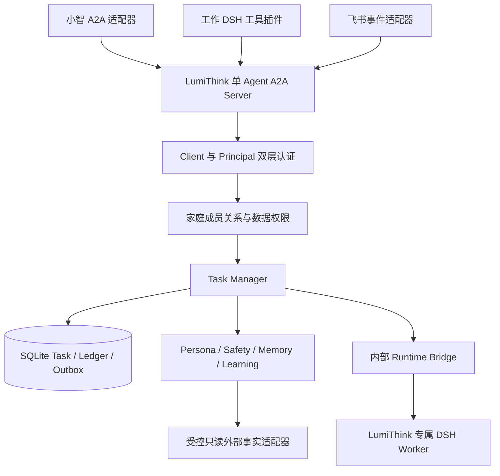

# LumiThink 架构

**基线：A2A 整体方案 V1.1 / Task 契约 V1.0，2026-10-25。设计评审通过（Design GO）。P0/P1 获准开展，协议互通、真实取消、设备验收和部署切换仍受各阶段 Gate 约束。**

## 组件与权威边界

| 对象 | 权威组件 | 不可混淆的边界 |
| --- | --- | --- |
| Client | 接入认证 | 哪个应用调用；不是自然人身份 |
| Principal / household | 身份授权服务 | 可信绑定到用户及家庭；A2A tenant 路由值不能充当家庭认证 |
| Conversation / contextId | 会话管理 | 按家庭、参与者、用途及渠道隔离；跨渠道显式授权续接 |
| Task / Artifact | Task Manager | 唯一写入者；SDK Store 接入同一事务，不另存一份状态 |
| Turn / Execution / epoch | 编排与 Runtime Bridge | 一个 Task 可有多个顺序 Turn；执行回调需核对代际和租约 |
| 公开输出 | Safety + Task Manager | 准入后只追加；原始 token、工具日志、状态提示不直接进入 TTS |
| 发送 / 播放 | Channel Delivery | 不影响 Task 终态；不确定送达不重新推理 |
| 事实 / 记忆 | 领域服务及外部来源 | 共享事实按权限复用，原始对话不无条件合并 |

同一 Agent 提供陪伴、学习事实查询和监护人建议。身份和数据范围控制每次访问；Agent Card Skill 是能力声明，不是授权或可靠的业务路由参数。P1 不建设完整租户管理平台，先用一个家庭、少量明确用户、固定角色和集中授权函数验证边界。

## 执行与取消

1. 验证 Client、Principal、请求、当前权限和幂等键；事务保存 Task、输入关联和派发记录，尽早返回真实 taskId。
2. Worker 派发前重新检查权限、取消意图、配额及租约；内部执行复用现有 DSH Bridge。
3. 输出先经准入，再原子更新聚合 Artifact 与 Outbox；事件携带片段 ID、UTF-8 字节区间和摘要。
4. CancelTask 持久化意图并关闭旧输出准入，实际停止后结算；完成与取消竞争只允许一个终态。SSE 断开不取消。
5. 如果真实执行完成而取消后输出被抑制，仍可为 COMPLETED，但 Task metadata 标明回答不完整。客户端不能把部分 Artifact 当完整答案。
6. 重启先恢复租约、取消、删除和撤权记录；执行是否已启动不确定时，不盲目重发可能有副作用的工作。

## 数据与语音边界

家庭是共享数据的隔离边界，用户及关系决定读写范围。声纹只识别候选人，私有记录需要已认证渠道确认的短期设备授权；未知或换人时不继承上一人的权限。工作 DSH 与飞书使用可信用户绑定，不接受消息中自报家长身份。

小智继续管理 VAD/ASR/TTS 与设备即时止播；首期 A2A 传文本和结构化结果。播放水位由渠道管理，A2A 核心没有设备播放 ACK。外部 ChildEvidence 接入先只读且保留来源，不复制为第二份事实权威。

删除和处理授权撤回优先于常规留存；Task、Outbox、缓存、待发消息和运行时旧上下文一并处理，恢复前重放独立删除台账。访问撤销立即生效，但不自动删除其他合法主体仍有权持有的全部家庭共享事实。

## 契约及迁移

完整规范见 [A2A_DESIGN](A2A_DESIGN.md)、[TASK_LIFECYCLE](TASK_LIFECYCLE.md)、[JSON 示例](fixtures/a2a-v1.0/README.md) 和 [ADR-0012](adr/0012-a2a-family-agent.md)。

既有 [Web API](API_CONTRACT.md)、[内部 Runtime](VOICE_RUNTIME.md) 和 [旧 Gateway UDS](VOICE_GATEWAY_PROTOCOL.md) 保留其实现说明；不能用旧进程内状态和设备绑定语义替代新 Task/身份契约。P0/P1 Gate 通过前保持现有接线，逐渠道迁移和回滚见 [ROADMAP](ROADMAP.md)。历史架构可从 Git 历史查阅。
