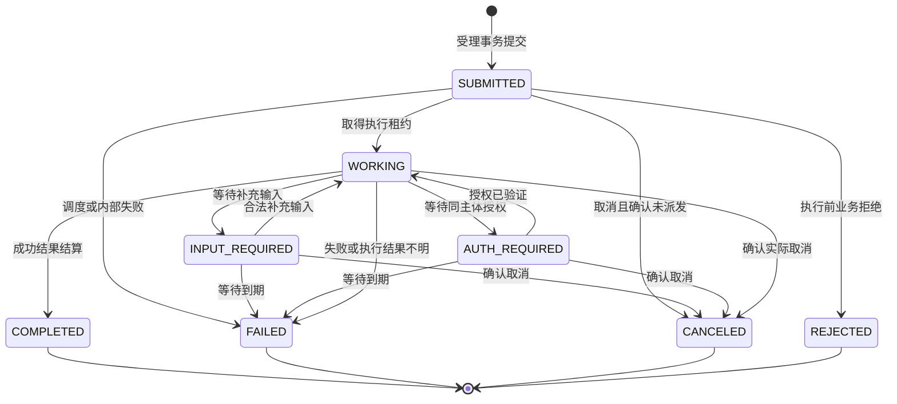
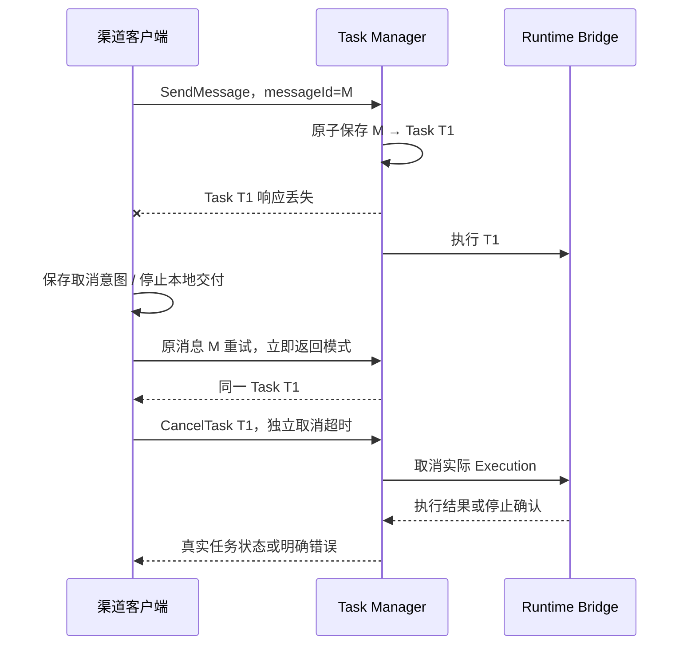

# LumiThink Task 生命周期与运行时执行契约

| 项目 | 内容 |
| --- | --- |
| 配套方案 | [整体方案 V1.1](A2A_DESIGN.md) |
| 文档版本 | 1.0，随整体方案 V1.1 新增 |
| 日期 | 2026-10-25 |
| 状态 | Design GO；P1 实现和互通验证待完成，含第二轮复评细节补充 |
| 对应意见 | TASK-01、A2A-01、CLIENT-01，以及消息幂等和资源隔离补充 |

## 1. 范围与强制约束

本文定义 A2A Task、内部 Turn、Runtime 执行、输出、取消和恢复之间的权威关系。它是 LumiThink 的应用实现约定，不扩展 A2A 的公开任务状态或新增任务 RPC。

1. 所有成功受理的正式业务交互均产生或关联真实 Task；不以独立 Message 绕过任务生命周期。
2. Task Manager 是对外 Task 状态和公开 Artifact 的唯一写入者。协议层、运行时和定时任务只提交命令或事件。
3. 任务状态、请求账本、公开结果和事件发布记录受统一仓储事务管理。
4. 对外 Task 终态不可逆；迟到回调只能进入内部诊断和资源回收记录。
5. 持久记录取消意图，不将发出取消、关闭连接或 `whenIdle()` 返回单独当作取消成功。
6. Task 生成状态与 Channel Delivery 独立。已完成结果的发送或播放失败不改写 Task。
7. 身份、Task 归属和当前权限在操作时检查，权限快照只用于追踪，不延续已撤销授权。

认证或参数校验失败可以直接返回标准错误，不创建 Task。业务请求已受理后，业务拒绝、执行失败和取消通过对应任务状态表达。

## 2. 对象及权威归属

| 对象 | 所属组件 | 核心内容 |
| --- | --- | --- |
| A2A Task | Task Manager | Task ID、Context、操作主体、当前状态、版本、已准入 Artifact |
| Conversation | 会话管理 | 家庭、参与者、用途、Context 映射、活动轮次及会话代际 |
| Turn | 轮次编排 | Task、输入消息、执行代际、输出准入开关、策略版本、取消意图 |
| Runtime Execution | Runtime Bridge | 执行 ID、Worker ID、租约、原始执行结果、工具副作用和清理结果 |
| Request Ledger | Task Manager 仓储 | 幂等键、请求指纹、Task 映射、保留期限及墓碑 |
| Event Outbox | Task Manager 仓储 | 已提交待发布事件、任务内序号、Artifact 及片段关联 |
| Channel Delivery | 渠道组件 | 展示 / 发送 / 播放水位、重试和止播，不写入 Task 状态 |

一个 Context 可关联多个 Task；一个 Task 可因补充输入而产生多个 Turn。一个 Turn 可以有执行尝试记录，但首期不自动重跑已经启动且结果未知的执行。

每个回调必须关联 `task_id + turn_id + execution_id + epoch + worker_lease`。缺少关联信息、执行代际不符或租约失效的回调不得修改任务或输出。

任务主体在受理后固定。语音从受限主体升级为已验证用户、或切换说话人时，新建相应授权会话 / Task；不能通过续传消息给旧任务换一个操作用户。

## 3. A2A 状态机

下图使用状态简写，实际线格式采用 A2A 1.0 SDK 的 `TASK_STATE_*` 枚举。`cancel_requested`、`cancel_pending` 和 `quarantined` 仅为内部字段。

| 目标状态 | 必须满足的条件 |
| --- | --- |
| SUBMITTED | 已认证、完成去重受理，Task 和调度记录已提交 |
| WORKING | 执行归属和资源配额明确，进入有效执行阶段 |
| INPUT_REQUIRED / AUTH_REQUIRED | 已记录需要补充的内容；等待时间有上限；不占用活动模型请求资源 |
| COMPLETED | 收到有效执行成功结果，结果准入和任务结算通过，或实际成功已先于取消生效 |
| CANCELED | 已确认没有派发，或收到匹配执行的停止确认并完成必要的受控执行收敛 |
| FAILED | 有确定失败原因，或到达截止时间仍无法确认执行结果，且已禁止后续输出并隔离执行 |
| REJECTED | 受理后的业务判断明确拒绝，未启动业务执行 |

终态后的新消息使用新 Task；针对同一已受理消息的幂等重试只查询原任务，不算向终态任务追加消息。

## 4. 原子受理与调度

### 4.1 受理顺序

1. 校验客户端凭据、操作主体、家庭范围、Context / Task 访问权及请求格式。
2. 计算幂等键和业务请求指纹，查询 Request Ledger。命中重复请求时先按 §5 处理，不重复扣减执行配额。
3. 新请求检查容量。容量不足时返回明确错误，不创建无界队列。
4. 同一数据库事务中登记请求键、Task / 补充消息、Turn、必要 Context 映射、资源预留和待调度记录。
5. 事务提交后才能返回 Task 或派发 Runtime。对于立即返回或流式调用，优先发送 Task 标识。
6. 调度器通过条件更新领取唯一执行租约，推进状态，并在 Runtime Bridge 登记 Execution ID 后启动执行。

SDK 的请求处理器不得另行创建一份任务，或在取消回调返回时自行假设已取消。SDK Task Store 与自建仓储必须适配到同一权威写入路径，此点列入 P1 检查。

### 4.2 状态转换事务

状态更新同时检查 `expected_state + state_version + turn_epoch + execution_id`。只有一个竞争事件可以成功更新版本；失败者重新读取状态，按新状态处理，不能无条件覆盖。

事务内更新状态、合并已准入 Artifact、写入事件 Outbox 和必要的资源状态。事务外调用模型、外部工具、网络和实际取消，避免长时间持有 SQLite 写锁。

单进程互斥只作为性能措施，正确性依赖持久化约束。首期运行单个调度权威实例；未来多实例须验证租约及数据库竞争，不能依赖内存锁扩容。

## 5. 消息幂等及首响应丢失

### 5.1 唯一键和请求指纹

唯一键为：`agent_id + household_id + principal_id + client_id + channel + messageId`。

身份和 channel 来自已认证绑定，不能由请求方自由填充以绕过去重。访问令牌更新不改变稳定主体和客户端 ID。设备未验证用户使用稳定的受限主体及连接会话绑定，不能在未知说话人之间复用私人上下文。

指纹以规范化业务请求计算：包括原始 Message 的内容、Context / Task 引用和影响执行的业务配置；排除 JSON-RPC ID、令牌、`returnImmediately`、历史长度和展示选项。首期仅支持受控文本及数据输入；不能对可变外部 URL 的内容只散列 URL 就声称输入一致。

首次不含 Context 时，保存原始“未提供 Context”的请求及服务端实际分配值。重试应重发原消息，不补入新字段。指纹规则使用固定版本，升级时保留旧版本比较能力。

### 5.2 重复消息结果

| 情况 | 行为 |
| --- | --- |
| 同键、同指纹，任务处理中 | 返回原 Task，按请求模式等待或订阅，不创建新 Turn |
| 同键、同指纹，任务已终结 | 返回有权查看的原 Task 快照；不重开运行 |
| 同键、不同指纹 | 返回 JSON-RPC 参数错误，附稳定的应用原因 `message_id_conflict`；不生成新任务 |
| 结果已清理，墓碑仍在 | 返回明确的已清理结果；按绑定使用标准错误及应用原因，不重跑 |
| 当前权限已撤销 | 拒绝访问，即使请求键已存在也不能返回旧结果 |
| 同一未完成 Task 的补充输入 | 使用新的 messageId；独立去重后关联原 Task，按状态创建下一 Turn |

应用原因是错误说明中的业务标识，不是新增 A2A 方法或私有任务状态。HTTP / JSON-RPC 绑定的错误编码由锁定 SDK 的规范映射处理。

### 5.3 找回丢失的首个 Task 响应

恢复请求只使用标准 A2A 消息操作。已终态 Task 不调用 Subscribe；读取快照即可。客户端保存原消息及其 ID，不能依赖模型再次调用工具重新生成一个 ID。

如果首个请求实际上没有到达，重试仍可能创建任务，因此该流程不是“取消先于创建”保证。首期早期取消恢复仅用于只读 / 无副作用交互；未来写工具应先受理并获得 Task 标识，再进入明确提交阶段，且依然需要独立的写入幂等约束。

### 5.4 保留窗口

自动重试窗口初始为 24 小时；完整 Task 结果建议保留 7 天；请求键、指纹和必要墓碑至少保留 30 天。过期任务和清理时刻可在应用 metadata 或错误说明中表达。

客户端超过重试窗口后禁止静默重发，需明确重新发起业务请求。服务器完全清理去重记录后无法无限期保证唯一执行；业务写操作的幂等记录必须满足自身更严格的保留要求。删除个人正文及撤回数据处理授权优先于上述常规窗口：清理 Task 输入、Artifact、含正文 Outbox、缓存、渠道待发内容及运行时上下文，仅保留必要墓碑。请求指纹使用服务端持久密钥的版本化 HMAC，不留下明文或可枚举的无密钥短句摘要。撤销访问立即阻断相应主体；共享事实是否删除按处理授权范围判断。

## 6. 正文准入与发布

Runtime 只产生候选结果。Task Manager 接收候选时依次检查执行归属、epoch、任务状态、当前权限、取消意图及安全准入，再持久化为公开 Artifact。

### 6.1 固定规则

- 回答正文使用稳定 Artifact ID，首次创建，后续只追加；公开后不改写前缀。`append`、`lastChunk` 均属于 `TaskArtifactUpdateEvent`；Artifact metadata 仅放稳定属性，逐片段事件由 Outbox 保存。Task 快照是聚合结果，不能据此假定可恢复所有片段事件。
- 工具内部事件和推理过程不进入公开 Artifact；结构化业务结果使用独立数据 Artifact。
- 片段放在 `TaskArtifactUpdateEvent.metadata.lumithinkOutput`，包含 `version: 1`、稳定 `chunkId`、正文 UTF-8 字节范围 `[startByte, endByte)` 及该片段的 SHA-256 摘要。它是应用契约，标准文本客户端可忽略。
- 片段与 Outbox 在同一事务保存；重发保持片段 ID、位置及摘要。
- 更新事件的 `lastChunk` 不等同于 Task 完成。失败、取消仍可能留下此前已交付的部分结果。
- 正文消费位置、播放位置和生成位置分别记录；相同文本出现两次不等于重复事件。

### 6.2 顺序、快照及慢客户端

Outbox 按任务内序号发送。订阅建立时，将当前 Task 快照和对应内部事件游标作为一致性切点，再发送切点之后的事件，避免快照和后续增量之间丢失或重复。

Task 已完成并不禁止授权客户端读取既有结果；已有连接可按顺序收到终态之前已提交且仍获准交付的片段，再收到终态事件。禁止的是终态后由迟到 Runtime 回调生成新的公开正文。

取消、权限撤销或用户切换关闭对应交付准入，尚未发送的正文在发送前重新检查。已发入网络或已播放的内容不能撤回，应由渠道进一步止播。慢客户端使用有界发送队列；溢出时断开该流并允许通过快照恢复，不阻塞整个 Task Manager。

重连时客户端根据快照和持久消费水位重建文本。无法证明音频消费位置时不自动补播完整快照。Task Manager 不需要知道 TTS 队列或音频帧位置。

## 7. 取消契约

### 7.1 处理步骤

1. 验证取消者对目标 Task 的取消权限，读取当前状态和执行关联。
2. 已终态任务和重复取消按锁定 A2A 规范及 SDK 的标准语义响应，不自行创造成功形态或错误码。P1 固定已取消仍保留、已清理、已完成和并发重复取消的实际返回 Fixture；重复请求不能重新执行取消副作用。
3. 未终结任务在事务中写入取消意图、请求时间和原因，关闭新正文准入，提升该 Turn 的隔离代际，并登记取消命令。原 Execution 标识仍保留，便于接收其停止结果。
4. 未派发任务以与调度领取相同的条件更新检查“未派发”，成功后直接结算 CANCELED；已被领取的必须进入实际取消路径。
5. Runtime Bridge 对匹配 Execution 发出停止请求，核对执行完成事件、工具状态和资源释放结果。
6. Task Manager 根据 §7.2 结算。成功响应只在能确认取消时返回 CANCELED，不以“停止等待”作为成功证据。

取消意图关闭正常正文准入，但不阻断可信的执行结果和清理事件。执行结果仍按原 Execution / 租约关联进入取消结算通道。

### 7.2 完成、失败与取消竞态

| 观测及提交顺序 | Task 结算 | 输出及审计 |
| --- | --- | --- |
| 完成事务已经提交，随后收到取消 | 保持 COMPLETED；取消返回不可取消 | 渠道仍可本地止播，不能改写生成结果 |
| 取消赢得未派发任务的条件更新 | CANCELED | 不启动 Runtime，不产生新正文 |
| 已运行，Bridge 确认该 Execution 因取消停止 | CANCELED | 保留已公开部分结果，记录停止及工具副作用 |
| 已记录取消意图，但 Bridge 报告执行实际成功完成且取消未生效 | COMPLETED | 记录“取消过晚”；取消后未准入正文不再自动交付，不能谎报已停止推理 |
| Runtime 明确失败，尚无已确认取消结果 | FAILED | 保存失败及取消尝试记录 |
| 当前工具阶段不可取消 | 保持非终态直到实际结果，CancelTask 返回不可取消 | 保持停止后续交付的意图，禁止进一步启动可阻止的新动作 |
| 取消调用超时，执行结果仍未知 | 暂维持原非终态，内部 cancel_pending | 返回明确的失败 / 超时响应，不声称 CANCELED；后台继续核对 |
| 到达停止截止时间仍不能确认执行停止 | FAILED，原因记录 execution_stop_unconfirmed | 隔离 Worker，阻止输出和后续资源分配，后台继续清理 |
| 任意终态之后收到迟到完成、正文或取消事件 | 保持原终态 | 仅追加内部诊断或清理结果，不恢复任务 |

Task 结算表示本服务对请求的结果；执行审计单独记录 Runtime 是否成功、是否被强制停止，以及工具副作用。Task CANCELED 不表示所有外部副作用已回滚，FAILED 也不等同于底层进程已退出。

如果取消后 Runtime 完成且最终正文不完整，`Task.metadata.lumithinkResult` 设置 `version: 1`、`outputSuppressedAfterCancel: true`、`answerComplete: false`，状态说明明确“执行已完成，后续输出已抑制”。客户端显示部分结果标识，不补播、不标记完整回答；保留 COMPLETED 表示真实执行结果。标准客户端能忽略 metadata，但 LumiThink 渠道适配器必须实现此解释，列入互通验收。终态事件必须包含一致的可读说明；只收到状态事件而未取得最终 Task metadata 的客户端，应通过已授权 GetTask 确认结果，不能仅凭 COMPLETED 推断完整回答。

### 7.3 初始截止时间与隔离

验证配置：CancelTask 响应最多等待 2 秒；超过后返回标准内部错误映射及“取消结果未确认，可查询任务”的说明，持久取消意图继续有效。配套客户端不得将这类错误理解为取消意图已丢失。

Runtime 协作取消宽限期为 5 秒；之后可对具备独占归属的 Worker 执行强制终止，总停止核对期限为 10 秒。数值属于初始保护配置，需经 P1 实测复核。不能为了达到耗时指标而提前报告成功。

强制终止前校验 Worker 租约，确保不会杀死其他用户的活动执行。`whenIdle()` 只有与匹配 Execution 终结、无仍在运行的受控工具和租约释放一起验证时，才能作为停止证据。无法控制的外部工具请求单独记录为结果待核对，不能自动重试。

### 7.4 DSH 客户端取消传播

DSH 工具在发起请求前保存稳定 messageId、原请求和本地调用映射。收到 Task ID 后立即持久化，随后进行轮询或订阅。

工具 Abort 时先停止本地呈现，再通过独立清理请求发送 CancelTask。清理请求使用独立 AbortController / 超时，不能携带已 aborted 的工具 signal。Task ID 未取得时，按 §5.3 恢复原请求映射并取消；恢复结果和取消结果均记录。

网络失败或凭据过期时，按照有限重试和有效授权续签处理；清理未完成需在客户端显示或记录，不能伪装成功。插件进程退出后仍需由已保存的待清理记录及服务端执行期限兜底。

## 8. 工具副作用与权限撤销

首期学习服务只读。未来写入工具必须使用业务操作幂等键，在执行前和提交前检查身份、当前关系、Task / Turn 有效性及写入权限。

与任务账本同数据库的写入可通过事务协调；外部服务写入必须有独立幂等和结果查询机制。外部请求可能已提交但响应丢失时，记录待核对，不重新执行。取消不能替代业务补偿或事实纠正。

权限撤销由身份服务提高绑定或策略版本，Task Manager 关闭受影响结果准入并发起内部取消。查询、订阅和工具提交必须重新授权。共享会话或模型上下文已包含撤销范围的数据时，暂停原上下文并从仍获准的数据重建，不能只给模型增加一句“不要提及”。

## 9. 重启恢复

首期优先保证状态真实和不重复执行，不承诺自动续跑所有中断任务。

| 持久状态 | 恢复行为 |
| --- | --- |
| 已提交 Task 和调度记录，确认未启动执行 | 重新领取租约；再次检查取消、授权和资源配额 |
| 已登记 Execution，但不能判断是否启动 | 按执行结果未知处理，不能自动当作未启动重新派发 |
| 已启动执行，进程仍存活且可核对租约 | 先核对原执行；首期不重复提交用户输入，可停止并结算失败 |
| 已启动执行，Worker 已退出 | 记录中断失败；不自动重放可能有副作用的执行 |
| 取消意图已保存 | 优先恢复取消与隔离，不能正常续跑 |
| 已终态 | 保持不变，授权读取原结果；对残留进程只做清理 |
| INPUT_REQUIRED / AUTH_REQUIRED | 在有效期限内保留等待；主体、权限或上下文无效则失败 |
| Outbox 未发送 | 重发已提交且仍获准的事件；片段 ID 不改变 |
| 渠道未发送或发送结果不明 | 由 Channel Delivery 恢复；无法确定送达时记录不确定，不重新触发推理 |

启动扫描期间，未确认归属的 Worker 不加入可用池。任务状态恢复和 Worker 清理进度分别可观测。备份恢复必须一并考虑 Request Ledger 和 Task，否则旧请求可能重新执行。删除台账及当前撤权记录独立于可回滚快照保存；恢复时先重放删除和撤权、清理缓存及待发事件，再开放服务。旧备份隔离并按周期过期或可用的密钥销毁处理，不能以 7 天 Task 留存为由复活已删正文。

## 10. P1 必须产出的验证证据

| 用例 | 验证内容 |
| --- | --- |
| 官方客户端完整闭环 | 真实 Worker 创建、正文、查询、结束和取消 |
| 并发同消息受理 | 一个 Task、一个有效执行；不同内容明确冲突 |
| 首响应丢失 | 原消息恢复取得同 Task，随后实际取消 |
| 取消与调度竞争 | 未派发取消成功时无 Worker 启动；已领取时进入真实取消 |
| 取消与完成竞争 | 只有一个最终状态，结果反映实际执行，终态后不增加正文 |
| 非协作 Worker | 取消超时不报成功；强制终止或隔离证据完整 |
| 权限撤销 | 已有流、查询、工具提交和上下文重用均受限 |
| 存储与启动故障点 | 事务提交前后、执行登记前后、Outbox 发布前后重启不重复派发 |
| 流与快照切点 | 无缺口；重复片段被识别；合法重复文字不被丢弃；事件 metadata 与 Artifact 快照归属正确 |
| 取消后的完成结果 | COMPLETED + outputSuppressedAfterCancel 被呈现为不完整回答；重复取消按标准错误 Fixture 验证 |
| 删除与留存优先级 | 删除后输入/正文/Outbox/缓存不可访问，仅剩最小墓碑；撤权立即生效，恢复前必须重放删除台账 |
| 容量耗尽 | 模型任务满载时查询与取消仍可处理，SQLite 不因外部调用持锁 |

每个用例保存版本、配置、执行关联、状态版本顺序及实际 Worker 证据；不保存真实儿童正文或凭据。配套 DSH 插件的 Abort 传播在 P2 另行验收，不能以官方客户端通过代替插件通过。

## 11. 参考与实现边界

- [A2A v1.0.1 规范](https://github.com/a2aproject/A2A/blob/v1.0.1/docs/specification.md)及[数据模型](https://github.com/a2aproject/A2A/blob/v1.0.1/specification/a2a.proto)：公开状态、操作和事件结构的依据。
- [候选插件 client.ts](https://github.com/ryubyte/dsh-a2a/blob/main/src/client.ts)和[outbound.ts](https://github.com/ryubyte/dsh-a2a/blob/main/src/outbound.ts)：本地等待取消与远端任务取消分开的源码观察；接入需固定提交版本。

本文的原子仓储、取消结算、消息保留期、资源截止时间及输出元数据均为 LumiThink 应用设计，尚未完成代码验证。若实际 SDK 默认行为与本文冲突，应调整接入适配或在复评中明确变更，不能悄悄降级这些契约。

协议示例见 [JSON Fixtures](fixtures/a2a-v1.0/README.md)。这些示例完成 JSON 结构与字节摘要检查，不代替官方 SDK 编解码、真实 Worker 或数据库测试。
